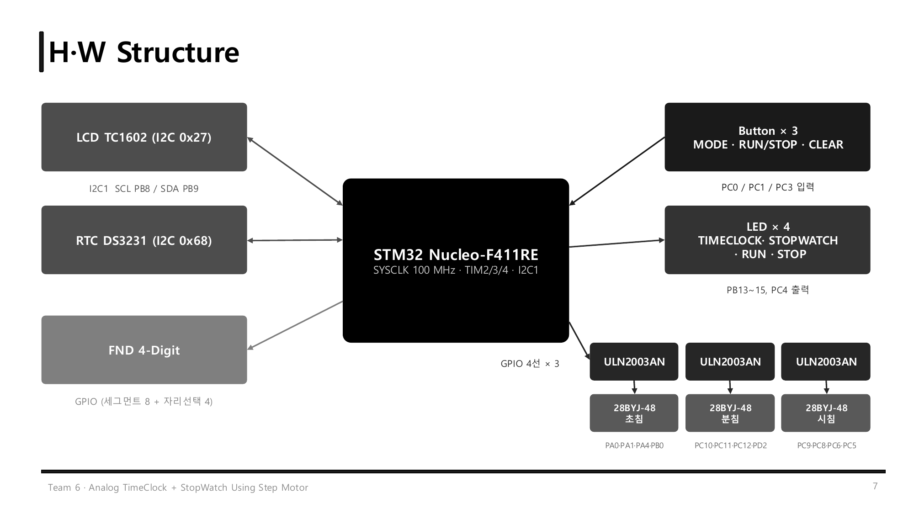
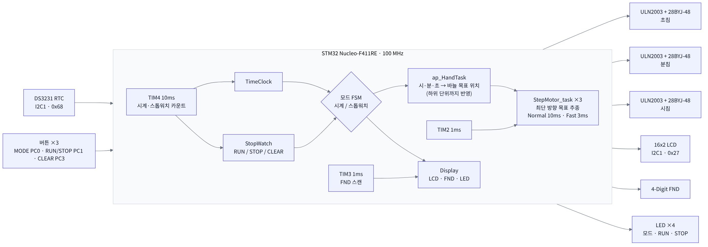
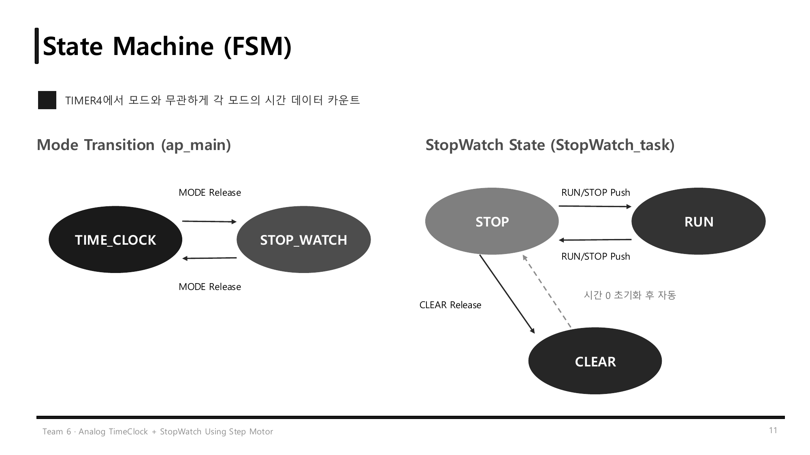
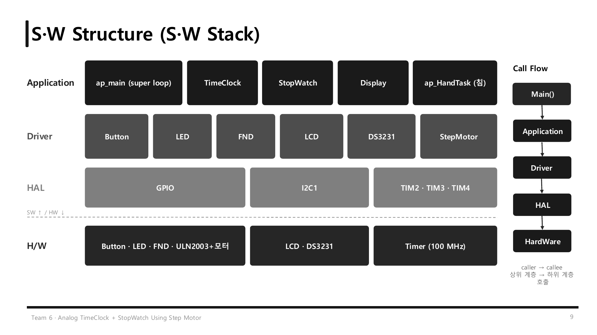

# STM32 Analog Clock + StopWatch (Team 6)

STM32 Nucleo-F411RE와 **스텝 모터 3개(시·분·초침)** 로 만든 아날로그 시계 겸 스톱워치입니다.
DS3231 RTC의 시간을 실제 바늘 위치로 바꿔 움직이고, 스톱워치 모드에서는 같은 바늘로 경과 시간을 보여 줍니다. 시간은 LCD와 4자리 FND에도 함께 표시됩니다.

> 4인 팀 프로젝트 (2026.10)
> **담당: 스텝 모터 드라이버와 바늘 구동 로직, RTC 초 단위 동기화** (PR #4, #5)
>
> 📑 발표 자료: [docs/StepMotor_AnalogTimeClock_StopWatch.pdf](docs/StepMotor_AnalogTimeClock_StopWatch.pdf)

## System Overview



### System Flow

위 그림의 블록을 따라 데이터가 이렇게 흐릅니다.

1. **시간 소스 (TIM4 · RTC DS3231)**
   TIM4가 10ms마다 시계와 스톱워치를 카운트합니다. 시계는 100ms마다 I2C로 DS3231을 읽어 RTC 초에 맞춥니다.
2. **버튼 → 모드 FSM**
   MODE(PC0)로 `TIME_CLOCK ↔ STOP_WATCH`를 바꾸고, 스톱워치 모드에서는 RUN/STOP(PC1)과 CLEAR(PC3)로 측정을 제어합니다.
3. **시간 → 바늘 목표 위치 (`ap_HandTask`)**
   현재 모드의 시·분·초를 한 바퀴 4096 스텝 기준의 목표 위치로 바꿉니다. 한 단계 아래 단위까지 반영해 목표가 연속으로 움직입니다.
4. **모터 구동 (TIM2 1ms → ULN2003 × 3 → 28BYJ-48 × 3)**
   TIM2 인터럽트에서 세 모터가 목표 쪽으로 한 스텝씩 하프스텝 패턴을 출력합니다. 평소에는 10ms 간격, 모드 전환처럼 크게 벌어지면 3ms 간격으로 따라잡습니다.
5. **표시 (LCD · FND · LED)**
   LCD(I2C 0x27)에 시각·날짜 또는 스톱워치 시간을, FND에 `분.초`를 표시합니다. FND는 TIM3 1ms 인터럽트로 한 자리씩 스캔합니다. LED 4개는 현재 모드와 RUN/STOP 상태를 보여 줍니다.

> **설계 원칙**: super loop는 LCD의 I2C 출력 때문에 느려서, 시간에 민감한 모터 스텝·FND 스캔·시간 카운트는 모두 타이머 인터럽트에서 처리합니다.



## 주요 기능

| 기능 | 동작 |
|---|---|
| **TimeClock 모드** | DS3231 RTC 시각을 바늘이 가리킴 · LCD: `Time hh:mm:ss` / 날짜·요일 · FND: `분.초` (0.5초 간격 DP 점멸) |
| **StopWatch 모드** | RUN / STOP / CLEAR, 10ms 단위 측정 · 바늘이 스톱워치 시간으로 이동 · LCD 2행: `SW:hh:mm:ss:cc` · FND: `분.초.밀리초` |
| **Analog Hand Drive** | 28BYJ-48 3개, 1바퀴 4096 스텝, 목표 위치를 부드럽게 추종, 모드 전환 시 목표 시간을 빠르게 추적 |

| 입출력 | 할당 |
|---|---|
| 버튼 | MODE(PC0) 시계↔스톱워치 · RUN/STOP(PC1) · CLEAR(PC3) |
| LED | 시계 모드(PB15) · 스톱워치 모드(PB14) · RUN(PC4) · STOP(PB13) |

### 상태 머신



- **모드 전환 (ap_main)**: MODE 버튼을 뗄 때마다 `TIME_CLOCK` ↔ `STOP_WATCH`
- **스톱워치 (StopWatch_task)**: RUN/STOP 버튼을 누를 때마다 `STOP` ↔ `RUN`, CLEAR 버튼을 떼면 0으로 초기화 후 `STOP`
- 시간 카운트는 TIM4 인터럽트에서 하므로, **모드를 바꿔도 시계와 스톱워치 모두 계속 측정**됩니다.

## 바늘 구동 방식 (담당 파트)

### 1. 시간 → 목표 위치 계산
한 바퀴(28BYJ-48 하프스텝 기준 4096 스텝)를 각 바늘의 주기로 나누고, **한 단계 아래 단위까지 반영**해서 목표 위치가 연속으로 변하게 했습니다. 그래서 바늘이 1초·1분 단위로 툭툭 끊기지 않고 부드럽게 움직입니다.

```c
uint32_t centiSec = sec * 100 + msec;          // 60초에 1바퀴
uint32_t minSec   = min * 60 + sec;            // 60분에 1바퀴
uint32_t hourMin  = (hour % 12) * 60 + min;    // 12시간에 1바퀴

StepMotor_setTarget(&motor_sec,  centiSec * STEPS_PER_REV / 6000);
StepMotor_setTarget(&motor_min,  minSec   * STEPS_PER_REV / 3600);
StepMotor_setTarget(&motor_hour, hourMin  * STEPS_PER_REV / 720);
```

### 2. 목표 추종 (`StepMotor_task`)
- **12시 기준**: 위치 0이 12시, 시계 방향(CW)으로 0~4095 증가
- **최단 방향 회전**: 남은 거리가 반 바퀴(2048 스텝) 이하인 쪽으로 돌아감
- **거리 기반 2단 속도**: 목표와 68 스텝(1초 분량) 넘게 벌어지면 **3ms 간격(Fast)**, 따라잡으면 **10ms 간격(Normal)**
- **하프스텝 구동**: `step_table` 8개 패턴을 IN1~IN4에 출력, 이동 중에는 코일 전원을 유지해 정지 토크 확보

### 3. 타이머 인터럽트에서 구동
메인 루프는 LCD의 I2C 출력 때문에 느려서, 시간에 민감한 모터 스텝·FND·시간 카운트는 모두 인터럽트에서 처리합니다.

| 타이머 | 주기 (PSC, ARR) | 역할 |
|---|---|---|
| TIM2 | 1ms (100-1, 1000-1) | `StepMotor_task()` × 3, 세 바늘을 한 스텝씩 이동 |
| TIM3 | 1ms (100-1, 1000-1) | `Disp_ISR()` → FND 다이나믹 구동 |
| TIM4 | 10ms (1000-1, 1000-1) | `TimeClock_ISR()`, `StopWatch_ISR()` 1/100초 카운트 |

### 4. RTC 읽기
- `HAL_GetTick()`으로 **100ms가 지났을 때만** RTC를 읽어, LCD와 같이 쓰는 I2C 버스 부하를 줄임
- `HAL_I2C_Mem_Read`로 0x68의 레지스터 0x00~0x07을 한 번에 읽고 BCD → 10진 변환
- 초가 바뀔 때 `msec = 0`으로 맞춰 RTC 초에 동기화, 날짜는 시가 바뀔 때만 다시 읽음

## 트러블슈팅: 모드 변경 시 스텝 모터 탈조

| | Fast (모드 변경 시 추적) | Normal (평소 추종) | 결과 |
|---|---|---|---|
| Before | 2 ms (500 pps) | 10 ms (100 pps) | 모드 전환 시 탈조 발생 |
| **After** | **3 ms (333 pps)** | 10 ms (100 pps) | 탈조 없이 추적, 반 바퀴 약 6.1 s |

- **현상**: 시계 ↔ 스톱워치 모드를 바꾸면 바늘의 목표 위치가 한 번에 크게(최대 반 바퀴, 2048 스텝) 바뀜. 새 위치로 빠르게 따라가는 도중 모터가 스텝을 놓침(탈조). 오픈 루프 제어라 탈조 후에는 `position` 값과 실제 바늘 위치가 계속 어긋남
- **원인**: 빠른 추적 간격(`STEP_FAST_DELAY_MS`)을 2ms로 잡아, 스텝 주파수(500 pps)가 28BYJ-48이 따라갈 수 있는 응답 주파수보다 높았음. 코일 자계는 다음 상으로 넘어갔는데 로터가 따라가지 못함. 기어드 모터라 고속일수록 토크가 급감하고, 정지 상태에서 바로 고속으로 출발한 것도 원인
- **해결**: `STEP_FAST_DELAY_MS`를 **3ms(333 pps)** 로 늘려 스텝 주파수를 낮춤 → 탈조 없이 목표 위치까지 추적

```c
#define STEP_FAST_DELAY_MS      3   // 목표와 많이 벌어졌을 때 (모드 변경 등), 2ms는 탈조 발생
#define STEP_NORMAL_DELAY_MS   10   // 평소 추종 속도
#define STEP_CATCHUP_THRESHOLD (STEPS_PER_REV / 60)   // 1초 이상 차이나면 빠르게
```

## 하드웨어

### BOM

| 부품 | 모델 / 사양 | 수량 | 용도 / 인터페이스 |
|---|---|---|---|
| MCU 보드 | STM32 Nucleo-F411RE (Cortex-M4, 100 MHz) | 1 | 메인 제어 |
| RTC 모듈 | DS3231 | 1 | I2C1 (0x68), 시각/날짜 유지 |
| Character LCD | TC1602A 16x2 (PCF8574 I2C) | 1 | I2C1 (0x27), 시각·날짜·스톱워치 표시 |
| Step Motor | 28BYJ-48 (5V, 4096 step/rev) | 3 | 시·분·초침 |
| 모터 드라이버 | ULN2003 | 3 | GPIO 4선 → 모터 코일 구동 |
| 7-Segment | 4-Digit FND | 1 | 분.초 / 스톱워치 숫자 표시 |
| Tact Switch | Push Button | 3 | MODE, RUN/STOP, CLEAR |
| LED | 적색 LED | 4 | 모드 / RUN / STOP 표시 |

### Pin Map

| 기능 | 핀 |
|---|---|
| I2C1 (LCD, RTC) | PB8(SCL), PB9(SDA), 100 kHz |
| 초침 모터 IN1~4 | PA0, PA1, PA4, PB0 |
| 분침 모터 IN1~4 | PC10, PC11, PC12, PD2 |
| 시침 모터 IN1~4 | PC9, PC8, PC6, PC5 |
| 버튼 MODE / RUN·STOP / CLEAR | PC0 / PC1 / PC3 |
| LED 시계 / 스톱워치 / RUN / STOP | PB15 / PB14 / PC4 / PB13 |
| FND 자리 선택 D1~D4 | PA5, PB6, PC7, PA10 |
| FND 세그먼트 | PA6, PA9, PB5, PB10, PA8, PA7, PB3, PB4 |

## 소프트웨어 구조



```
STM32_Analog_Clock_Project_Team6/Core/Src
├── ap/
│   ├── ap_main.c          # 모드 FSM, 바늘 목표 계산(ap_HandTask), 타이머 콜백
│   ├── TimeClock/         # RTC 기반 시계
│   ├── StopWatch/         # 스톱워치 (RUN/STOP/CLEAR)
│   └── Display/           # LCD · FND · LED 출력
└── driver/
    ├── stepmotor/         # 스텝 모터 (하프스텝, 목표 추종, 2단 속도)
    ├── ds3231/            # I2C RTC
    ├── lcd/  fnd/  button/  led/
```

## 결론 및 고찰

- DS3231 RTC 시간에 맞춰 세 바늘이 움직이는 시계를 구현했고, 초 사이 구간은 밀리초까지 계산해 바늘이 부드럽게 움직이도록 함
- 버튼, FSM, 타이머 인터럽트로 모드 전환과 스톱워치 RUN/STOP/CLEAR가 정상 동작
- 한계: 전원을 켤 때 바늘의 시작 위치(12시)를 손으로 맞춰야 함
- 향후: DS3231 내장 알람 기능을 활용한 기능 추가

## 개발 환경

STM32CubeIDE, STM32 HAL (STM32F4xx), C, Git/GitHub (브랜치 + Pull Request 협업)
